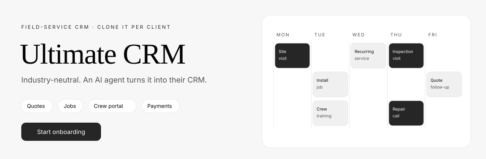
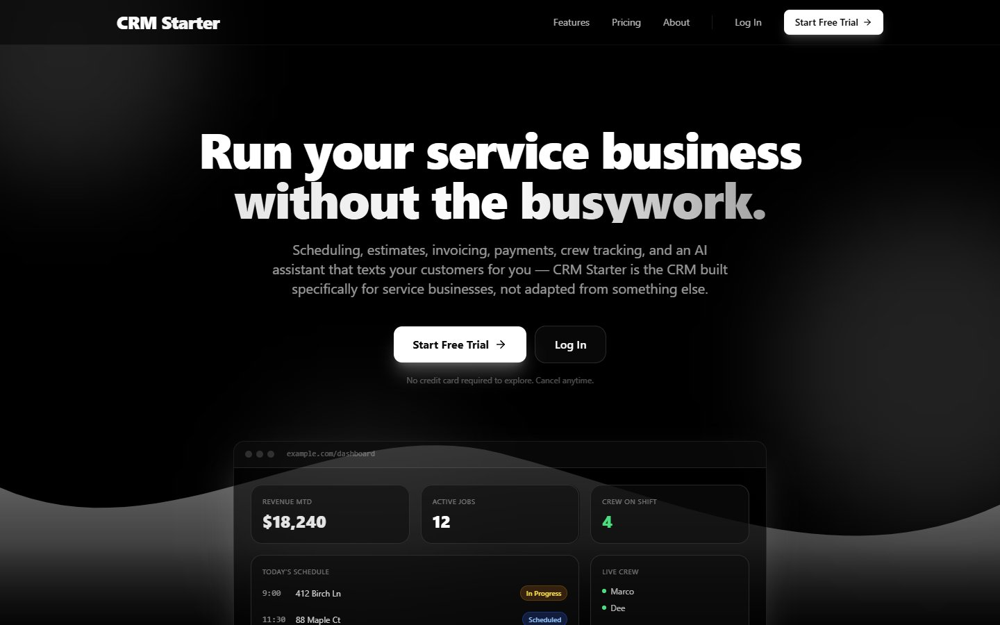
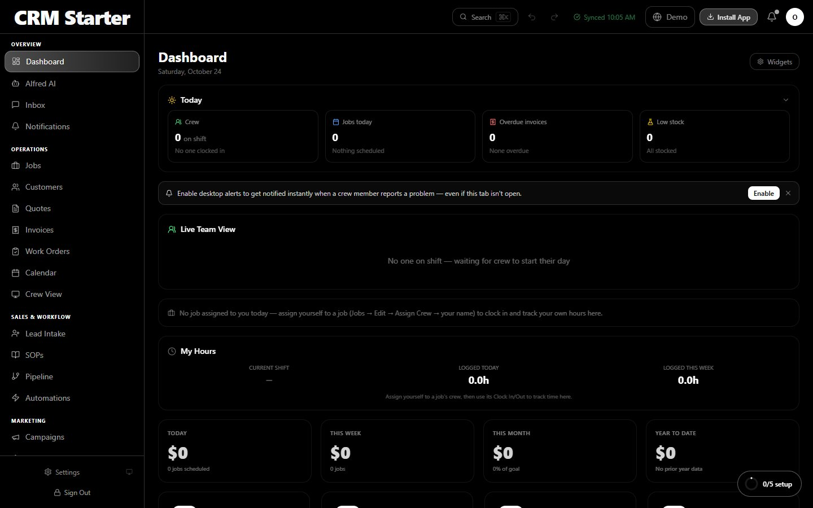
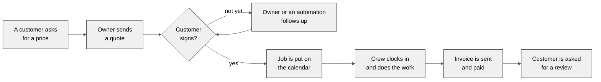
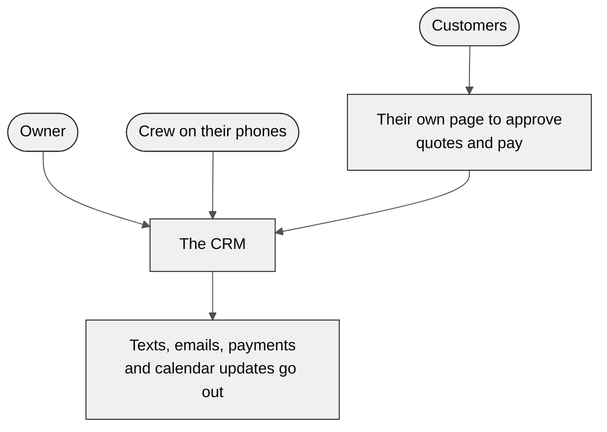
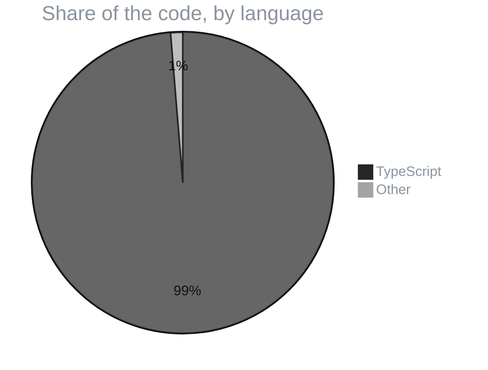

<p align="center">
  
</p>

<p align="center">
  
  
  
  
</p>
<p align="center">
  
  
  
  
  
  
  
  
</p>

<h3 align="center">A free, industry-neutral CRM for field-service businesses. Paste the link into Claude and it builds the owner's own version.</h3>

<p align="center">
  <a href="#01--what-it-does">What it does</a> ·
  <a href="#02--screenshots">Screenshots</a> ·
  <a href="#03--from-first-call-to-five-star-review">From first call to five-star review</a> ·
  <a href="#04--how-a-business-gets-its-own-crm">How a business gets its own CRM</a> ·
  <a href="#05--who-uses-it">Who uses it</a> ·
  <a href="#06--part-of-claude-business-god-mode">Part of Claude Business God Mode</a> ·
  <a href="#07--what-its-written-in">What it's written in</a> ·
  <a href="#-field-manual">Field manual</a> ·
  <a href="#-license">License</a>
</p>

> [!TIP]
> **🤖 Pasted this link into Claude or ChatGPT?** AI assistants: read [`docs/SETUP_WIZARD.md`](https://raw.githubusercontent.com/F0rger123/ultimate-crm-template/main/docs/SETUP_WIZARD.md) first. It explains what this is in plain words, which questions to ask, and how to set it up step by step. Plain-text index: [`llms.txt`](https://raw.githubusercontent.com/F0rger123/ultimate-crm-template/main/llms.txt).


<p align="center"></p>

## 01 · What it does

**The Ultimate CRM Template** is a complete CRM for businesses that send people out to do jobs: cleaners, pressure washers, landscapers, remodelers, HVAC, pest control. Leads come in, turn into quotes, become scheduled jobs, get invoiced and paid, and end with a review request. The template is blank on purpose: an AI agent interviews the owner, makes a private copy for their business, and builds their version.

| | |
|---|---|
| **Sales** | Leads and pipeline, quotes with e-signing, invoices, payments by hand, Stripe or Square |
| **Jobs** | Calendar, recurring work, crew assignments, work orders, checklists and photos, route planning |
| **Team** | Crew phone portal, clock in and out, live team view, hiring, training and how-to guides |
| **Customers** | Client portal to approve quotes and pay, reviews and referrals |
| **Messages** | Two-way text inbox, Gmail sending, templates and campaigns |
| **Smart tools** | Automations builder, reports and goals, and **Alfred**, the built-in AI assistant |

**Quick start with an AI agent.** Open Claude Code (or Codex, Cursor, Gemini) in an empty folder and paste:

```text
Create a new CRM for my business from https://github.com/F0rger123/ultimate-crm-template. Begin onboarding.
```

**By hand:** `git clone`, `npm install`, copy `.env.example` to `.env` with your Supabase details, then `npm run dev`. Full steps are in the field manual below.

## 02 · Screenshots

<p align="center">
  
  
</p>
<p align="center"><sub>Left: the public landing page. Right: the owner dashboard on a brand-new install, before any customers are added.</sub></p>

## 03 · From first call to five-star review



## 04 · How a business gets its own CRM

The repository is the memory. Chat history is not.

```mermaid
%%{init: {'theme':'base','themeVariables':{'primaryColor':'#f0f0f0','primaryTextColor':'#050505','primaryBorderColor':'#262626','lineColor':'#525252','secondaryColor':'#ffffff','tertiaryColor':'#f7f7f8','clusterBkg':'transparent','clusterBorder':'#262626','noteBkgColor':'#ffffff','noteTextColor':'#050505','actorBkg':'#f0f0f0','actorTextColor':'#050505','actorBorder':'#262626','signalColor':'#525252','signalTextColor':'#525252','labelBoxBkgColor':'#f0f0f0','fontFamily':'inherit'}}}%%
flowchart LR
    A["Owner pastes the link<br/>into an AI assistant"] --> B["Assistant asks about<br/>the business"]
    B --> C["Answers are saved<br/>in the project notes"]
    C --> D["A private copy is made<br/>just for this business"]
    D --> E["Assistant builds and<br/>puts it online"]
    E --> F["Progress notes saved"]
    F -->|next session picks up here| E
```



## 05 · Who uses it



## 06 · Part of Claude Business God Mode

<table>
<tr>
<td align="center" width="25%"><a href="https://github.com/F0rger123/claude-business-god-mode"><b>👑 Business God Mode</b></a><br><sub>the umbrella: run a whole business with Claude</sub></td>
<td align="center" width="25%"><a href="https://github.com/F0rger123/claude-meta-ads-god-mode"><b>📣 Meta Ads God Mode</b></a><br><sub>paid campaigns that fill this CRM with leads</sub></td>
<td align="center" width="25%"><a href="https://github.com/F0rger123/CLAUDE-SEO-GOD-MODE"><b>🔎 SEO God Mode</b></a><br><sub>organic leads and reviews</sub></td>
<td align="center" width="25%"><a href="https://github.com/F0rger123/claude-video-editing-god-mode"><b>🎬 Video Editing God Mode</b></a><br><sub>job-site footage into reels and ads</sub></td>
</tr>
</table>

## 07 · What it's written in



<p align="center"></p>

## 📚 Field manual

# FOR AI AGENTS CUSTOMIZING THIS CRM

You were probably told something like *"Create a new CRM from this starter for my client. Begin onboarding."* or *"This is an open-source CRM repo — help me set it up."*

**Shortest path: follow [`docs/SETUP_WIZARD.md`](docs/SETUP_WIZARD.md)** — interview the owner (blueprint, current progress, problems, goals, ideas, design preferences), set up the accounts and deploy, then build their version. In more detail:

1. **Read [`AGENTS.md`](AGENTS.md)** — the rules every agent follows on this repo.
2. **Read [`docs/ONBOARDING.md`](docs/ONBOARDING.md).**
3. **Decide which situation you're in** — open `docs/client/project-state.json`:
   - You're in `F0rger123/ultimate-crm-template` itself, or `onboarding.status` is `"not_started"` → **fresh client.** Follow [`docs/START_NEW_CLIENT.md`](docs/START_NEW_CLIENT.md): create a separate client repo, then begin onboarding.
   - Otherwise → **existing project.** Follow [`docs/RESUME_PROJECT.md`](docs/RESUME_PROJECT.md): read everything in `docs/client/` and brief the owner.
4. **Don't modify code before you understand the current requirements**, unless the owner explicitly tells you to.

Everything the owner tells you that should outlast the conversation — requirements, bugs, ideas, branding, workflows, integrations, decisions — gets written into `docs/client/` before the session ends. The repo is the memory; chat history isn't.

| Doc | Purpose |
|---|---|
| [`docs/SETUP_WIZARD.md`](docs/SETUP_WIZARD.md) | Start here: interview → technical setup → build plan |
| [`AGENTS.md`](AGENTS.md) | Rules for every agent |
| [`docs/START_NEW_CLIENT.md`](docs/START_NEW_CLIENT.md) | Copy-paste prompts + setup for a new client |
| [`docs/RESUME_PROJECT.md`](docs/RESUME_PROJECT.md) | Copy-paste prompt for continuing a project |
| [`docs/ONBOARDING.md`](docs/ONBOARDING.md) | The guided onboarding conversation |
| [`docs/PROCESS.md`](docs/PROCESS.md) | Statuses, evidence levels, reopening, idea → requirement |
| [`docs/ARCHITECTURE.md`](docs/ARCHITECTURE.md) | Code conventions that prevent known bugs |
| [`docs/client/`](docs/client/) | The client project's memory (blank in the starter) |
| [`docs/templates/`](docs/templates/) | Pristine copies of the client docs |

---

A reusable, industry-neutral CRM for field-service businesses — customers, quotes, invoices, jobs, scheduling, a crew/employee portal, a client portal, payments, automations, messaging, and an AI assistant ("Alfred").

Stack: **React 18 + TypeScript + Vite** (frontend), **Supabase** (Postgres, Auth, Storage), **Cloudflare Pages + Pages Functions** (hosting and server-side API in `functions/api/`).

## What's included

| Area | Highlights |
|---|---|
| Customers & leads | Customer records, tags/folders, lead intake + public lead form, pipeline, referrals, reviews |
| Quotes & invoices | Line items, packages/options, deposits, e-signature, client portal approve/decline/pay |
| Jobs & scheduling | Calendar, recurring jobs, crew assignment, work orders, checklists, photos/files, route optimization |
| Team | Employee portal (`#/portal`), invites, clock in/out, live team view, time tracking, pay, hiring, onboarding, training, SOPs |
| Payments | Provider layer in `src/lib/payments` — **Manual** (default), **Stripe**, **Square** |
| Messaging | Twilio SMS (two-way inbox), Gmail send, email templates, campaigns, promotions |
| Automations | Visual workflow builder, scheduled server-side runner |
| Google | OAuth sign-in, Gmail, Calendar sync, Maps/Places autocomplete |
| AI | Alfred assistant (in-app chat, SMS, voice), multi-provider model support |
| Inventory | Supplies & equipment with reorder levels and suppliers |
| Analytics | Dashboard KPIs, reports, budget, expenses, goals |

## Requirements

- **Node.js 20+** (see `.nvmrc`)
- **npm** (lockfile is `package-lock.json`)
- A **Supabase** project
- A **Cloudflare** account (Pages) for deploys

## Quick start

```bash
git clone https://github.com/<you>/ultimate-crm-template.git
cd ultimate-crm-template
npm ci
cp .env.example .env        # then fill in VITE_SUPABASE_URL / VITE_SUPABASE_ANON_KEY
npm run dev                 # http://localhost:5173
```

`npm run dev` serves the frontend only. Features that call `/api/*` (payments, SMS, AI, push, invites) need the Cloudflare Functions running — use a Pages preview deploy, or run locally with Wrangler:

```bash
npm run build
npx wrangler pages dev dist   # reads server secrets from .dev.vars (gitignored)
```

### Scripts

| Command | What it does |
|---|---|
| `npm run dev` | Vite dev server |
| `npm run build` | Type-check + production build to `dist/` |
| `npm run check` | Type-check, bundle-check every Cloudflare Function, build |
| `npm run check:functions` | Bundle-check `functions/api/*.ts` only |
| `npm run docs:check` | Validate `docs/client/` IDs and `project-state.json` |
| `npm run gen:vapid` | Generate a Web Push key pair |

## Environment variables

See **`.env.example`** for the full annotated list.

**Frontend (build-time, browser-visible):**

| Variable | Required | Notes |
|---|---|---|
| `VITE_SUPABASE_URL` | yes | Supabase → Project Settings → API |
| `VITE_SUPABASE_ANON_KEY` | yes | anon / publishable key (safe in the browser) |
| `VITE_VAPID_PUBLIC_KEY` | no | Web Push public key |
| `VITE_SQUARE_ENVIRONMENT` | no | `sandbox` or `production` (default) |
| `VITE_PLATFORM_ADMIN_EMAIL` | no | can moderate the feedback board |

**Server (Cloudflare Pages Functions — set as secrets, never in the frontend):**

| Variable | Required | Used for |
|---|---|---|
| `SUPABASE_URL`, `SUPABASE_ANON_KEY` | yes | every function |
| `SUPABASE_SERVICE_ROLE_KEY` | yes | server-side DB access (secret) |
| `APP_ORIGIN` | recommended | links in server-sent emails |
| `GOOGLE_CLIENT_ID`, `GOOGLE_CLIENT_SECRET` | for Google | token refresh (Gmail/Calendar) |
| `VAPID_PUBLIC_KEY`, `VAPID_PRIVATE_KEY`, `VAPID_SUBJECT` | for push | Web Push |
| `REMINDERS_CRON_SECRET`, `AUTOMATIONS_CRON_SECRET`, `CRON_SECRET` | recommended | protect scheduled endpoints |
| `STRIPE_CONNECT_CLIENT_ID`, `STRIPE_SECRET_KEY`, `STRIPE_PUBLISHABLE_KEY`, `STRIPE_WEBHOOK_SECRET`, `STRIPE_CONNECT_STATE_SECRET` | for Stripe Connect | optional |
| `SQUARE_ENVIRONMENT` | for Square | `sandbox` or `production` (default) |
| `PLATFORM_*` | no | only if you sell this CRM as SaaS |

Per-business credentials (Twilio, AI model keys, Stripe/Square accounts, Google refresh token) are entered by the owner in **Settings → Integrations** and stored server-side in the `owner_secrets`, `owner_stripe_accounts`, and `owner_square_accounts` tables (service-role only — never readable from the browser).

## Supabase setup

1. Create a project at [supabase.com](https://supabase.com).
2. **SQL Editor** → paste `supabase/schema.sql` → **Run**. This creates every table, function, RLS policy, storage bucket, and the new-user trigger. It's idempotent.
3. **Authentication → URL Configuration**: set *Site URL* to your app URL and add it (plus `http://localhost:5173`) to *Redirect URLs*.
4. **Authentication → Providers**: enable Email; optionally enable Google (needs a Google OAuth client — add the Gmail/Calendar scopes if you use those features). In Google Cloud, **publish the OAuth consent screen to Production** — while it is in Testing, Google expires saved sign-ins after 7 days and Gmail/Calendar disconnect weekly.
5. Optional: `insert into public.platform_admins (email) values ('you@example.com');` to moderate the feedback board.

Later schema changes: add numbered SQL files to `supabase/migrations/` (`0001_add_x.sql`, …) and run them in the SQL Editor. Double-quote camelCase column names.

## Cloudflare Pages deployment

1. Push this repo to GitHub, then Cloudflare → **Workers & Pages → Create → Pages → Connect to Git**.
2. Build command `npm run build`, output directory `dist`, Node version 20 (env var `NODE_VERSION=20` if needed).
3. **Settings → Variables and Secrets**: add the frontend `VITE_*` variables (used at build time) and the server variables above (mark keys/tokens as *Secret*).
4. Optional **Settings → Bindings → Workers AI**, name `AI` — enables free voice-memo transcription and voice replies for text-message Alfred.
5. Deploy. Functions in `functions/api/` are served at `/api/*`; `functions/api/_middleware.ts` loads the env for each request.

### Webhooks and schedules

| Integration | Point it at |
|---|---|
| Stripe | `https://<app>/api/stripe-webhook` |
| Square | `https://<app>/api/square-webhook?oid=<ownerId>` (events: `subscription.updated`, `invoice.updated`) |
| Twilio (incoming SMS) | `https://<app>/api/twilio-sms-webhook` (Messaging Service or phone number → "A message comes in") |
| Reminders (every 5–15 min) | `https://<app>/api/check-reminders?key=<REMINDERS_CRON_SECRET>` |
| Automations (every 15 min) | `https://<app>/api/run-automations?key=<AUTOMATIONS_CRON_SECRET>` |

Any external scheduler works (cron-job.org, GitHub Actions, Supabase `pg_cron` + `pg_net`).

## Payments

`src/lib/payments/index.ts` defines three providers; customers see exactly one at checkout (Settings → Integrations → *Customer checkout*):

- **Manual** — default, no setup. No online checkout; record cash/check/transfer payments on the invoice.
- **Stripe** — card payments, saved cards, recurring billing, refunds, customer import. Connect via Stripe Connect (platform env vars) or by pasting API keys in Settings.
- **Square** — card payments, recurring plans, refunds, webhook signature verification. The owner pastes their Square Access Token, Location ID, and Application ID in Settings.

### Sandbox vs production

| | Sandbox / test | Production |
|---|---|---|
| Stripe | use `pk_test_` / `sk_test_` keys (test cards like 4242 4242 4242 4242) | `pk_live_` / `sk_live_` keys |
| Square | `SQUARE_ENVIRONMENT=sandbox` **and** `VITE_SQUARE_ENVIRONMENT=sandbox`, plus Sandbox credentials from the Square Developer Dashboard | both set to `production` (default) with Production credentials |
| Supabase | use a separate Supabase project for staging | your production project |

Use a separate Cloudflare Pages preview/branch environment with its own variables for staging.

## Customizing for a new client

- **Branding**: company name, logo, colors, and phone are per-business settings (Settings → Company). The product name "CRM Starter" appears as a default/fallback — search the repo for it to rename.
- **Services & pricing**: Settings → Services (starter catalog lives in `src/lib/seed.ts`).
- **Checklists**: per-service checklist templates in Settings → Services; defaults in `EmployeePortal.tsx` / `CrewView.tsx` / `Dashboard.tsx`.
- **Message templates & automations**: `src/lib/seed.ts`, `src/hooks/useAutomationEngine.ts`, `functions/api/run-automations.ts`.
- **Alfred's personality/prompt**: `src/lib/utils.ts` (personalities) and the system prompt in `src/components/pages/AlfredPage.tsx`.

Record every client-specific decision in `docs/client/` as you go (see `AGENTS.md`).

## Security notes

- Never commit `.env*` files (except `.env.example`) or `.dev.vars`.
- The Supabase **anon key** is public by design; the **service-role key** must only ever be a Cloudflare secret.
- All business tables use owner-scoped RLS (`owner_id = current_owner_id()`); secrets tables have no client policies at all.
- Twilio webhook signatures are verified against the owner's own Auth Token.

## Project layout

```
src/
  App.tsx                 routing (hash-based), auth, data sync
  components/pages/       one file per screen (CRM, portals, marketing pages)
  components/ui/          shared components and modals
  lib/                    supabase client, payments, messaging, Google, utils
  hooks/                  automation engine, persistence, polling
functions/api/            Cloudflare Pages Functions (server API, webhooks)
supabase/schema.sql       baseline database schema
supabase/migrations/      incremental changes after the baseline
scripts/                  dev utilities (check, check:functions, docs:check, gen:vapid)
docs/                     agent process, onboarding, client project memory
AGENTS.md                 rules for AI agents (CLAUDE.md / GEMINI.md point here)
```

## 📜 License

Released under the [MIT License](LICENSE). Use it, fork it, ship it.

<p align="center"></p>

<p align="center">
  <sub>Built by <a href="https://github.com/F0rger123"><b>@F0rger123</b></a> · MIT licensed</sub>
</p>
